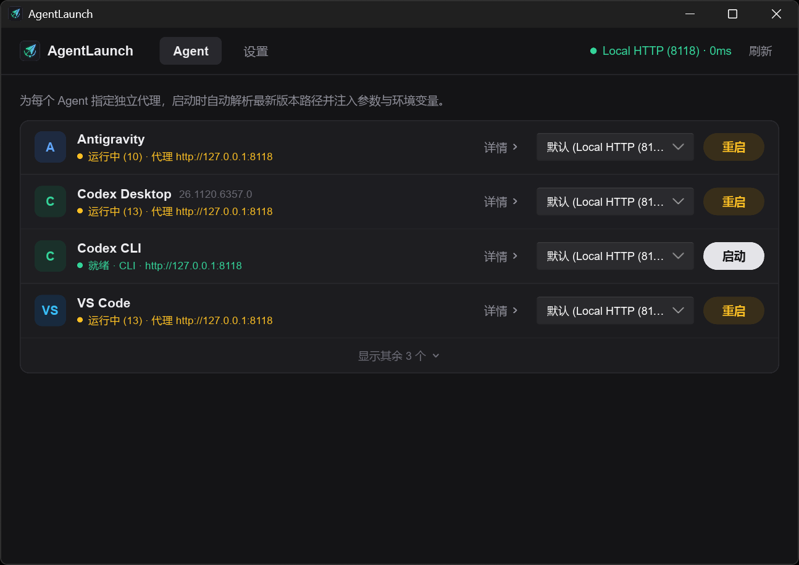

# AgentLaunch

给不想开全局 TUN 的人准备的轻量级 AI Agent 代理启动器。

不想为了跑 Codex、Claude、Antigravity 就把整台电脑的流量全劫持进 TUN 网卡？用 **AgentLaunch** 给每个 Agent 单独指定代理端口，互不干扰，支持 Windows 与 macOS。

## 原理

- **界面走参数**：Electron 应用启动时自动注入 `--proxy-server` 与 `--proxy-bypass-list`。
- **会话走环境变量**：同步注入 `HTTP_PROXY` / `HTTPS_PROXY` / `ALL_PROXY` / `NO_PROXY` 等变量，让 Agent 单独拉起的后台会话进程自动继承代理。
- **更新不丢路径**：像 Codex 这类更新后会换目录的应用，每次启动实时解析最新版路径，无需手动改配置。

## 快捷入口

在列表中点开任意 Agent 的 **「详情」→「创建桌面快捷方式」**，会在桌面生成一个保留原程序图标的快捷方式。平时直接双击就能静默注入代理启动（也支持直接固定到任务栏或绑定系统快捷键），连启动器界面都不用打开。

> 构建方式与项目架构说明见 [AGENTS.md](./AGENTS.md)。

在 macOS 上运行 `sh scripts/package-macos.sh` 可生成带应用图标的 `target/release/AgentLaunch.app`。双击打开后，可在「设置 → 外观」选择跟随系统、浅色或深色。
